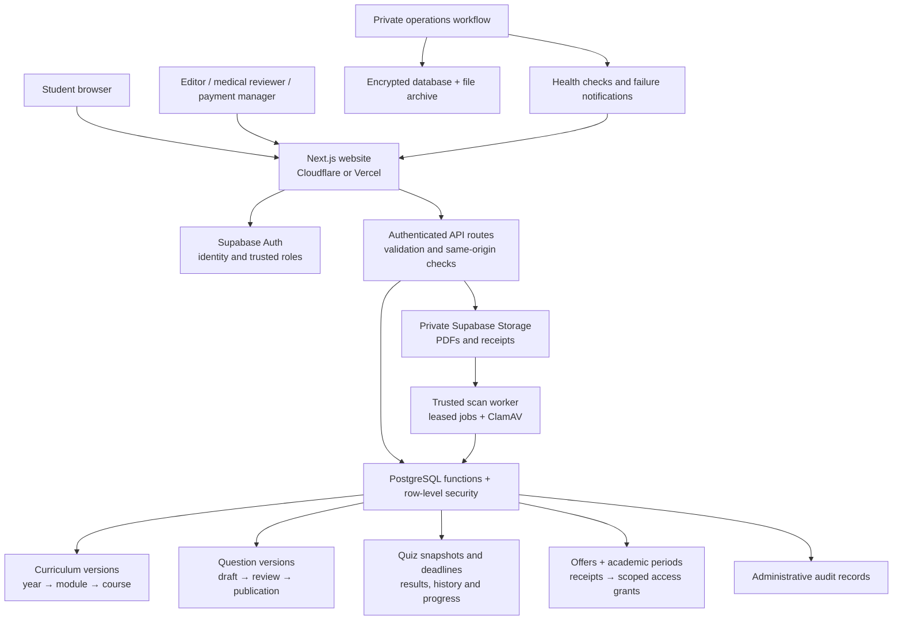
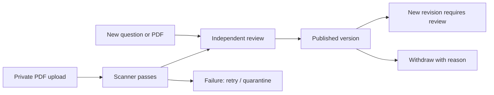

# MedQCM website architecture

Implementation date: 2026-10-21. This architecture was deployed to Supabase, Cloudflare and Vercel on 2026-10-23 after backup/restore and migration rehearsal. Hosted operations still require activation; see PROJECT_HANDOVER.md for verification limits. MedQCM remains a website. A future mobile client can use the same access rules and database operations after a deliberate mobile-auth/API design.

## System map



Browsers upload directly to private Storage using their own authenticated session and restrictive Storage policies. Downloads use a server-authorized, 60-second signed link. Neither browser nor web server needs a service-role key for ordinary requests. The scan worker and backup process have separate server-only credentials.

## Ownership and data

- `curriculum_releases`: faculty/programme version and academic-period label, with explicit source verification. A **study year** is a learning level; an **academic period** has actual start/end instants. The original 111 navigation modules are imported as draft curriculum, without claiming official approval.
- `curriculum_modules`, `curriculum_courses`: stable IDs and relationships. Moving a module between years/programmes requires a new ID, preventing a metadata edit from silently changing a purchased entitlement. Module renaming retains old attempt snapshots. Residency is a separate track represented by navigation value 8; medicine years are 1–7.
- `content_questions`, `question_versions`: identity and versioned payloads. Six seeds remain samples. Existing private drafts are retained and imported. A published version cannot be edited; a revised draft requires new independent review. Publishing requires verified curriculum and documented rights. The exam/practice catalog is a transactionally rebuilt projection, not a second editorial source of truth.
- `training_attempts`, private `exam_keys`: immutable selected questions and rule snapshots. Server-side exact-set scoring gives one point for a completely correct selection, zero otherwise; unanswered questions remain in the denominator. Timed running snapshots omit keys/explanations. An already-started session survives subscription expiry. Repeated submission returns the same result; saved drafts use revisions to reject conflicting tabs.
- `exam_definitions`: reviewed, immutable configurations for one module's approved pool. Question count, total time and attempt limit are captured at start. Retiring a definition stops new starts, preserving existing attempts. Attempt limits count all starts, including abandoned sessions. Multi-module exams and alternative faculty scoring need an explicit extension.
- `academic_periods`, `subscription_offers`, `access_grants`: offers have fixed terms/price/period; receipt submission snapshots those terms. Access is scoped to a selected medicine year, all medicine years, a module or residency. All-years excludes residency. Approval produces one grant per receipt and never extends a fixed academic end date. Renewals/upgrades are additional explicit purchases; proration/refunds are not automated. Revocation is audited. Existing unexpired legacy subscriptions retain their original broad scope until their recorded expiry.
- `course_documents`, private `document_jobs`: private immutable uploads, scan leases/retries, independent review, then publication. Unsupported/failed scans cannot publish. Authors cannot approve their own documents. Replacing PDF bytes requires a new record/upload. Scanning reduces risk; it is not a guarantee that every unsafe document will be detected.
- `content_audit`, `content_notices`: append-only administrative records through controlled functions. Withdrawal flags affected completed question-version snapshots without silently recalculating historical scores.

## Authorization

Trusted `auth.users.raw_app_meta_data.role` supplies staff roles. Profile metadata never supplies privileges or purchased scope. Roles: `admin` (all administrative capabilities), `content_editor` (curriculum/drafts/uploads), `medical_reviewer` (review/publication), `payment_manager` (offers/payment approval/revocation). Even an administrator cannot approve their own authored question, exam or PDF. Assign roles through a trusted administrative process, never public signup.

API routes validate bodies and same-origin mutations. Database functions independently enforce capabilities, ownership, lifecycle transitions and entitlements, including direct RPC calls. Private tables have no direct anonymous/authenticated grants. The only new anonymous RPC is `schema_health()`, which returns a non-sensitive schema-version marker for monitoring. Request budgets apply to high-risk database mutations. They do not replace provider-level anonymous/login abuse protection.

## Main user journeys

```mermaid
sequenceDiagram
    participant S as Student
    participant W as Website/API
    participant D as Database
    S->>W: Choose year and offer; submit receipt
    W->>D: Validate offer, scope, reference and private proof
    D-->>W: Pending request with fixed terms
    Note over W,D: Payment manager checks receipt and approves
    W->>D: Approve once, record scoped grant and audit
    S->>W: Start quiz in selected module
    W->>D: Check identity, module access and question pool
    D-->>W: Persisted attempt and safe question snapshot
    S->>W: Save answers / finish
    W->>D: Check ownership, revision and deadline; score once
    D-->>S: Saved result, history and progress
```



Question drafts have draft → in-review → approved → published states. PDF files pass scanning before in-review; reviewer approval and publication occur together. A published question replaces the previous active version atomically. Running/completed attempts keep their previous snapshot, including when the source is later withdrawn.

## Statistics contract

Session count and accuracy derive from completed attempts only. Accuracy = correct responses / all questions presented, including unanswered questions and repeated practice. Distinct questions seen is historical exposure, not mastery and not a fraction of today's changing catalog. The current catalog count is displayed separately. The mistakes queue uses the latest completed answer per module/question; a retry uses the current available version. Historical correction notices explain withdrawn versions without changing recorded marks.

## Code map

| Responsibility | Files |
| --- | --- |
| Curriculum/student discovery | `lib/content/`, `app/api/curriculum`, `components/content/CurriculumBrowser.tsx` |
| Editorial workflows | `components/admin/Workbench.tsx`, `app/api/admin/workspace` |
| Quiz/exams/history | `app/api/quiz`, `components/quiz/`, `app/[locale]/(dashboard)/quiz`, `lib/quiz/` |
| Subscription scope/review | `components/subscriptions/SubscriptionPanel.tsx`, `app/api/subscriptions` |
| Private PDF library/download | `app/api/documents`, `app/[locale]/(dashboard)/depot` |
| Authoritative data rules | Three `20261020000*` SQL migrations plus preceding migrations |
| Isolated database acceptance | `tests/database/architecture.mjs` |
| Browser acceptance | `tests/e2e/architecture.spec.ts`, `.github/workflows/staging.yml` |
| Scanning, monitoring and backup | `scripts/ops/`, `.github/workflows/operations.yml` |

## Rollout and operational limits

Follow `docs/OPERATIONS.md`. Migrations must precede the new application bundle; the old receipt-submission RPC is revoked during migration. Keep collection closed throughout. Use a maintenance window for the application/schema cutover. Existing data stays in place, but reverting only the frontend to the previous receipt UI is not a complete rollback. Prefer an additive correction; any database restore requires a verified backup and explicit data-loss decision.

Hosted scanner/backup/monitor scheduling, real restore acceptance, curriculum approval, reviewed medical content, commercial terms and production account/payment acceptance are separate launch gates. A repository workflow file does not mean the hosted service is configured or running.
